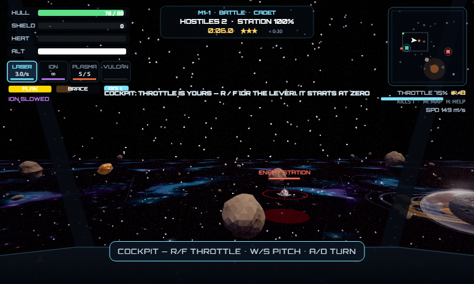
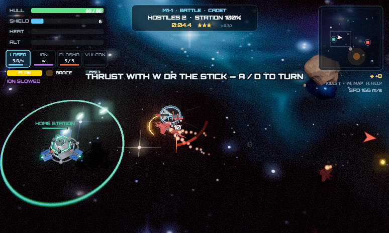
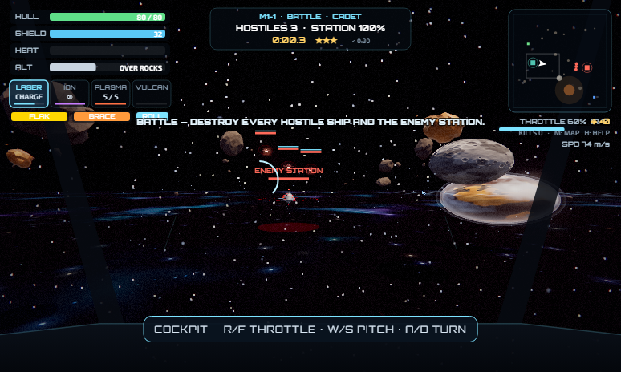

# Parsec Chronicles 3D

A single-file, fully offline 3D space-combat game. Fly a starfighter across 500 missions and 10
sectors — fight fleets, hunt marked aces, escort freighters, and face sector bosses. Switch between
a tactical **diorama** view and a first-person **cockpit** with full 3D flight.

**▶ Play in your browser:** https://mbnaveed15-sys.github.io/parsec-chronicles-3d/

No install, no network needed at runtime — everything (three.js, fonts, textures, audio) is bundled
into one `index.html`. Works on desktop and mobile.



## Highlights
- **Two views, one game.** Diorama (default): a tilted 3D battle board you command from above.
  Cockpit (press **B**): strap in and fly it yourself in full 3D.
- **Cockpit is a real 3D space.** Planets, moons, asteroids and enemy ships are spread through a
  volume — above, below and around you — under a starfield sky, not on a flat plane. A throttle you
  control (it starts at zero), pitch/yaw flight, afterburner and brake.
- **Pilot Assist.** Optional auto-climb, auto-flak, auto-brace and auto-roll, each with its own
  toggle, plus a "hide assisted buttons" option to declutter the touch HUD.
- **Arsenal.** Pulse/charged beam laser, ion, plasma, vulcan cannon, flak, barrel rolls, afterburner,
  target lock, and a heat/overheat model.
- **Progression.** Per-difficulty careers: Cadet/Pilot/Ace keep separate upgrades (20/40/60 level
  ceilings), ships, mods, cosmetics, campaign progress and **credit wallets**, so a maxed Cadet ship
  can't carry you through Ace. 8 upgrade tracks, unlockable hulls and trails, star ratings and bosses.
- **Anywhere.** Keyboard, gamepad, or a fully customizable touch layout (drag buttons, mirror,
  scale). Procedural music + SFX via Web Audio.

| Diorama command view | Cockpit combat |
|---|---|
|  |  |

## Controls

### Diorama (default)
| Key | Action |
|---|---|
| W / S | Thrust / reverse |
| A / D | Turn |
| R / F | Climb / brace |
| Space | Fire (hold for charged beam) |
| Q / Shift | Afterburner / brake |
| Z / X | Barrel roll |
| C / V / G | Switch weapon / vulcan / flak |
| E / M | Target lock / map |
| B | Cycle view: diorama → cockpit → tail (3D only) |

### Cockpit (press B)
| Key | Action |
|---|---|
| W / S | Pitch nose up / down |
| A / D | Yaw (turn) |
| **R / F** | **Throttle up / down** (starts at 0 — thrust follows the nose) |
| Q / Shift | Afterburner / brake |
| Space | Fire |
| Z / X | Barrel roll |
| B | Return to diorama |

On touch: the left stick pitches/yaws, a **throttle lever** appears on the left, and FIRE / BURN /
SHLD buttons handle weapons, boost and brake. Mission 1 walks you through the cockpit scheme.

View cycling is a diorama/3D control only. In Classic 2D the eye button, `B` binding and the cockpit/tail views are removed from the active scheme.

## Game modes
Battle · Total War · Boss · Hunted (ace duel) · Escort · Defend · Free Hunt — spread across
500 missions in 10 sectors, with weather (storms/fog), gravity wells, repair stations and waves.

## Build & deploy (for developers)
This folder is the working project: editable source + a one-command build + the GitHub Pages repo.
```
index.html            Playable build output (self-contained, offline)
src/game.html         Script A: gameplay, UI, HUD, audio, input
src/scriptB.js        Script B: three.js 3D renderer (authoritative)
src/fonts.embedded.css  Base64 Exo 2 + Orbitron
build.mjs             Bundles three.js + Script B -> index.html (no CDN)
publish.sh            git push -> GitHub Pages republishes the live link
```
```
npm install        # first time (three + esbuild)
npm run build      # regenerate index.html from src/
npm run publish    # commit + push; live link updates in ~30-60s
```
Edit gameplay/UI in `src/game.html`; edit the 3D renderer in `src/scriptB.js`; then `npm run build`.
Open `index.html` directly to play offline, or use the live link on phones.